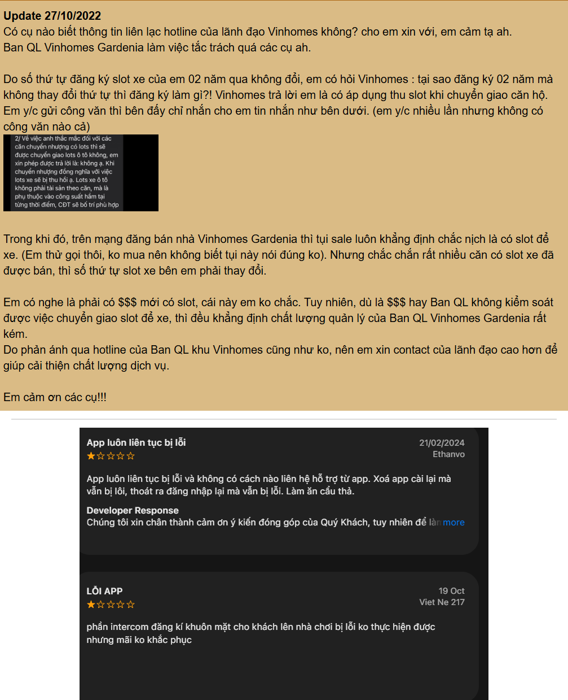

# CP4 — Review Snapshot #1 & #2: Đánh giá thực tế từ cư dân Vinhomes Resident

> File minh chứng và tổng hợp chi tiết cho Checkpoint 4 (Kiểm chứng thực tế — Customer Reviews Validation).  
> Nguồn: Dữ liệu đánh giá công khai của cư dân trên Google Play Store và Apple App Store cho ứng dụng **Vinhomes Resident**.

---

## 1. Review Snapshot #1 — Vấn đề đồng bộ và xử lý dịch vụ kéo dài

| Trường | Nội dung |
|---|---|
| **Người được hỏi (vai trò, nguồn)** | Cư dân tòa BE4, khu đô thị Vinhomes (Đánh giá Google Play · Hoa Như · 25/08/2026) |
| **Câu nói đáng nhớ nhất (nguyên văn)** | *"Quy trình đồng bộ App mất nhiều thời gian 1 tuần trời ko làm nổi thẻ ra vào và thẻ gửi xe. Mỗi tối mất 32k tiền gửi xe. Dịch vụ quá tệ tòa Be4"* |
| **Lần gần nhất gặp vấn đề này: chuyện gì đã xảy ra?** | Cư dân đăng ký làm thẻ gửi xe và thẻ ra vào qua app, nhưng hệ thống xử lý kéo dài cả tuần không xong, không có bộ phận nào phản hồi nguyên nhân hay tiến độ xử lý. |
| **Hiện đang xử lý bằng cách nào (workaround)?** | Chấp nhận gửi xe trả phí vé lượt bên ngoài (mất 32.000 VNĐ/tối) trong suốt thời gian chờ đợi ban quản lý xử lý. |
| **Mất bao lâu, bao lần?** | Kéo dài liên tục 1 tuần lễ; phát sinh thiệt hại tài chính thực tế mỗi ngày. |
| **Insight / opportunity rút ra** | Độ trễ xử lý các yêu cầu dịch vụ của cư dân gây thiệt hại kinh tế và bức xúc thật. Các yêu cầu về thẻ/tiện ích bị tắc nghẽn ở khâu đối soát và chuyển tiếp giữa BQL và bộ phận vận hành bãi đỗ xe. |

---

## 2. Review Snapshot #2 — Ý kiến gửi qua app không được phản hồi & Kênh hotline thay thế

| Trường | Nội dung |
|---|---|
| **Người được hỏi (vai trò, nguồn)** | Cư dân căn hộ Vinhomes (Đánh giá App Store · Ethanvo & Thu Huyen Nguyen trên Google Play) |
| **Câu nói đáng nhớ nhất (nguyên văn)** | *"App vô nghĩa vì ý kiến cư dân cũng k được giải quyết, cđt nên xóa app"* và *"App luôn liên tục bị lỗi và không có cách nào liên hệ hỗ trợ từ app."* |
| **Lần gần nhất gặp vấn đề này: chuyện gì đã xảy ra?** | Gửi phản ánh/góp ý qua ứng dụng nhưng không nhận được giải quyết hoặc trạng thái xử lý; không tìm thấy đầu mối liên hệ hỗ trợ trực tiếp trên giao diện ticket. |
| **Hiện đang xử lý bằng cách nào (workaround)?** | Nhà phát triển hướng dẫn cư dân chuyển sang gọi Tổng đài Chăm sóc Khách hàng **1900 2323 89 (nhánh 4)** để gửi ảnh và mô tả sự việc. |
| **Mất bao lâu, bao lần?** | Tình trạng lặp lại qua nhiều phiên bản cập nhật; cư dân phải thoát app hoặc gọi điện thoại ngoài ứng dụng. |
| **Insight / opportunity rút ra** | Cư dân mất niềm tin vào nút gửi phản ánh trên app vì không thấy trạng thái định tuyến minh bạch. Khi app không phản hồi kịp, cư dân buộc phải chuyển kênh sang hotline thoại làm tăng tải cho tổng đài viên. |

---

## 3. Bảng tổng hợp tín hiệu kiểm chứng

| Nguồn | Số mẫu | Tín hiệu xác nhận (Validation) | Tín hiệu phản bác (Invalidation / Boundary) |
|---|---:|---|---|
| **Google Play (Vinhomes Resident)** | 2 review tiêu biểu (Hoa Như, Thu Huyen Nguyen) | Cư dân bức xúc vì ý kiến gửi qua app bị chậm trễ hoặc không được giải quyết; phát sinh chi phí thật (32k/tối) do quy trình kéo dài cả tuần. | Review không chỉ nói về hỏng hóc kỹ thuật trong nhà (điện nước) mà phản ánh rất nhiều về **dịch vụ thẻ/đỗ xe** và thủ tục hành chính. |
| **Apple App Store (Vinhomes Resident)** | 2 review tiêu biểu (Viet Ne 217, Ethanvo) | Các lỗi dịch vụ (như đăng ký khuôn mặt/intercom cho khách) bị kéo dài "mãi không khắc phục"; người dùng lúng túng khi không biết kênh nào đang tiếp nhận. | **Tín hiệu phản bác quan trọng:** Ban quản lý có kênh Hotline hỗ trợ trực tiếp (1900 2323 89 nhánh 4) song song; nhiều trường hợp cư dân được điều hướng gọi tổng đài thay vì xử lý hoàn toàn trên app. |

---

## 4. Minh chứng hình ảnh thực tế

---

## 5. Kết luận nhóm đã sửa problem sau kiểm chứng

1. **Mở rộng phạm vi phân loại (Category Scope):**  
   Ban đầu nhóm chỉ dự định phân loại các sự cố hỏng hóc kỹ thuật trong nhà (điện, nước, điều hòa). Sau khi đọc review thực tế, nhóm nhận thấy nhu cầu phản ánh của cư dân phân bổ rất nhiều vào mảng **Dịch vụ cư dân & Tiện ích số (thẻ xe, thẻ ra vào, intercom, rác thải)**. Do đó, nhóm bổ sung danh mục định tuyến bao gồm cả 4 mảng nghiệp vụ cốt lõi của ban quản lý.

2. **Xác lập Ranh giới an toàn (Boundary) & Kênh khẩn cấp:**  
   Từ phản hồi của nhà phát triển về việc gọi Hotline 1900 2323 89 (nhánh 4), nhóm xác định rõ: **Hệ thống AI chỉ đóng vai trò phân loại và định tuyến các phản ánh phi khẩn cấp trên App**. Nếu phát hiện sự cố khẩn cấp hoặc lỗi hệ thống nghiêm trọng, giao diện sẽ kích hoạt nút gọi ngay đến Hotline tổng đài thay vì để ticket rơi vào hàng đợi xử lý.

