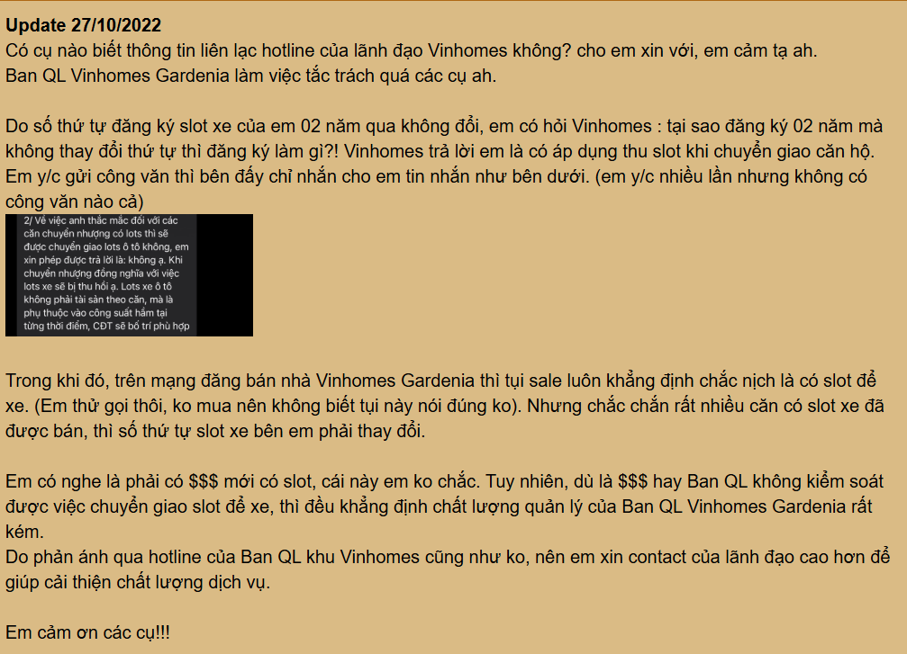
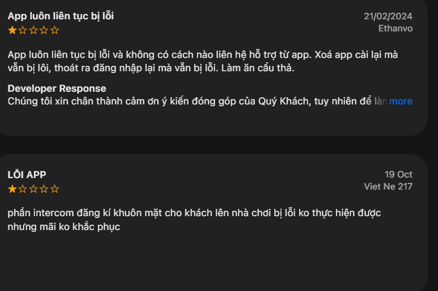

# Báo cáo nhóm — Day 02 Discovery & Problem Framing

> Bản chung của nhóm, viết trên repo do nhóm trưởng fork. Không copy file này sang repo cá nhân.
> Template chi tiết và prompt mẫu: [docs/01-worksheet.md](../../docs/01-worksheet.md). Bài mẫu: [docs/02-deliverable-example.md](../../docs/02-deliverable-example.md).

## 1. Thông tin nhóm

- Tên nhóm: TVCL
- Thành viên: xem `TEAM.md`
- Candidate problem được chọn (1 câu): Phân loại và định tuyến thông minh phản ánh của cư dân đến đúng bộ phận chuyên trách trên ứng dụng Vinhomes Resident.
- Quyết định cuối: Go / Not Yet / No-Go (sẽ chốt ở CP6)

---

## 2. Hội tụ nhóm (CP3)

### 2.1. Pitch


|  # | Người đưa ra     | Candidate (Job Story ngắn)                                            | Actor                                                                   | Bottleneck                                                                                                                          | Câu hỏi phản biện nhận được (ai hỏi)                                                                                                                                                                                                                      |
| -: | -------------------- | ---------------------------------------------------------------------- | ----------------------------------------------------------------------- | ----------------------------------------------------------------------------------------------------------------------------------- | ------------------------------------------------------------------------------------------------------------------------------------------------------------------------------------------------------------------------------------------------------------------ |
|  1 | Nguyễn Thanh Liêm  | Phân loại và điều phối sự cố từ nhóm chat các cơ sở       | giáo viên                                                             | sai sót và tìm kiếm lâu tin nhắn trong group                                                                                  | vũ hỏi rằng để ai đọc vào tin nhắn chat thì giải quyết vấn đề bảo mật thông tin, và quản lý thông tin nhảy cảm như thế nào khi ai đọc chat                                                                                            |
|  2 | Nguyễn Thanh Liêm  | phân loại chuyển ca dạy cho giáo viên khác khi có sự cố      | giáo viên                                                             | dò thủ công lịch học, gọi để xác nhận                                                                                     | vũ hỏi về vấn đề sự đồng ý của giáo viên khi được ai giao ca nếu không có cuộc gọi và thỏa thuận thực tế từ giáo viên đó, nếu như giáo viên đó chưa chuẩn bị cho buổi dạy đột xuất về tài liệu và kịch bản dạy |
|  3 | Nguyễn thanh Liêm  | Khi trạm sạc công cộng kín chỗ vào giờ cao điểm              | tài xế xe                                                             | di chuyển kiểm chứng từng trụ sạc                                                                                             | vũ hỏi liệu khách hàng có đồng ý với việc thêm các thiết bị như camera và loa thông báo cho các trụ sạc hay không nó sẽ rất tốn kém                                                                                                    |
|  4 | Nguyễn Thế Cường | Khi đánh giá video camera trước, tôi muốn biết kết quả biển | Kỹ sư phát triển và kiểm thử CV                                  | Bước nhận diện/hậu xử lý có thể sai; khâu gây trễ chưa đo, chưa kết luận                                           | Liêm hỏi trong tình trạng ban đêm thì camera có thể nhận dạng tốt hình ảnh. và thực sự rằng so với mắt thường thì ai phát hiện và phản hồi nhanh hơn con người không                                                               |
|  5 | Cường              | Đối chiếu hóa đơn sạc                                           | Nhân viên đối soát                                                 | Ghép và kiểm lệch, chưa đo phút/lô                                                                                          | liêm hỏi có thực sự tạo ra thêm doanh thu khi triển khai                                                                                                                                                                                                   |
|  6 | Cường              | Phân loại mô tả lỗi xe                                            | Nhân viên hỗ trợ kỹ thuật                                         | Đọc và phân loại triệu chứng; chưa đo giây/phiếu                                                                         | liêm khi các triệu chứng của nó có thể dẫn đến từ nhiều lỗi thì tiêu chí ưu tiên để chọn nơi chuyển phiếu ưu tiên là gì?                                                                                                              |
|  7 | Hồ Xuân Vũ        | Google Maps sai đường                                               | Người tham gia giao thông                                            | việc phải dừng xe hỏi người dân hoặc dò dẫm thực tế mất 5–7 phút giữa lòng đường, gây ùn tắc và nguy hiểm. | cường hỏi phương thức triển khai phương án như thế nào                                                                                                                                                                                                |
|  8 | Hồ Xuân Vũ        | chấm công bằng vân tay                                             | nhân viên, sếp                                                       | Khâu xếp hàng chờ đợi và chạm tay vào thiết bị chung gây chậm trễ và nguy cơ lây bệnh.                            | doanh nghiệp có thực sự muốn triển khai, trong khi hình thức cũ đã đáp ứng được nhiệm vụ điểm danh cho doanh nghiệp. mà phải bỏ đi để thay bằng camera thông minh                                                                    |
|  9 | Hồ Xuân Vũ        | thủ tục hành cho cựu sinh viên, sinh viên                        | sinh viên, cửu sinh viên                                             | lục lỏi các hồ sơ cũ, đối chiếu dữ liệu thủ công để xác thực và tạo phiếu yêu cầu                             | cường hỏi với tệp người dùng ít, và khách hàng ít thì nó thực sự khả thi trong thực tế                                                                                                                                                         |
| 10 | trí                 | Phân loại & Định tuyến ticket (Lăng kính: Lặp lại)            | Nhân viên tiếp nhận / Điều phối viên tổng đài CSKH           | đọc nội dung xem hình ảnh đính kèm để tạo ticket. chuyển sai ticket cho bên không có trách nhiệm                   | có thực sự phải tạo nhiều ticket đến nổi phải dùng đến ai                                                                                                                                                                                             |
| 11 | trí                 | Xác định thông tin thiếu sót                                     | Nhân viên CSKH / Kỹ thuật viên tiếp nhận                         | phải kiểm tra lại sự đầy đủ của thông tin                                                                                 | trường hợp này cũng ít khi xảy ra có thực sự cần giải quyết như vậy                                                                                                                                                                                 |
| 12 | trí                 | Bàn giao bối cảnh xử lý                                           | Điều phối viên ca trước & Kỹ thuật viên hiện trường ca sau. | Đọc lại toàn bộ lịch sử & log trao đổi                                                                                     | thực tế khi giao ca thì công việc chưa làm xong phải thực hiện cho xong hay lại phải làm cho xong mới đổi?                                                                                                                                         |

### 2.2. Cluster

| Cluster | Các candidate | Pattern chung |
|---|---|---|
| **A — Phân loại & Định tuyến yêu cầu/sự cố (Triage & Routing)** | Candidate #1 (Liêm), #4 (Trí), #5 (Trí), #6 (Trí), #9 (Cường) | Gom thông tin văn bản/hình ảnh phản ánh từ người dùng (ngôn ngữ tự nhiên, không cấu trúc), đọc hiểu nội dung, phân loại mức độ khẩn cấp và định tuyến chính xác đến đúng bộ phận chuyên trách để xử lý. |
| **B — Giao thông, Định vị & Thị giác máy tính (Mobility & Vision)** | Candidate #3 (Liêm), #7 (Cường), #11 (Vũ) | Thu thập và xử lý tín hiệu không gian/hình ảnh thực tế (camera, bản đồ, trạng thái trụ sạc) để cảnh báo sai lệch hoặc tối ưu di chuyển. |
| **C — Thủ tục hành chính & Vận hành nội bộ (Operations & Admin)** | Candidate #2 (Liêm), #8 (Cường), #10 (Vũ), #12 (Vũ) | Đối soát dữ liệu bảng tính, lịch trình, đối chiếu quy định thủ tục giấy tờ và quy trình vận hành giữa các bộ phận. |

### 2.3. Opportunity Solution Tree rút gọn

Gốc là **1 outcome**. Nhánh là **opportunity** (nhu cầu, pain), không phải tính năng hay công cụ.

```text
OUTCOME: Giảm thời gian phản hồi và tỷ lệ chuyển sai bộ phận khi xử lý phản ánh của cư dân Vinhomes
├── Opportunity A: Cư dân mô tả bằng câu chữ tự do, không theo cấu trúc, thiếu thông tin số phòng/vị trí cụ thể
├── Opportunity B: Danh mục phân loại phòng ban nội bộ bị chồng chéo (Kỹ thuật điện/nước vs Bảo trì tòa nhà)
└── Opportunity C: Điều phối viên đọc thủ công từng ticket, mở ảnh đối chiếu và chuyển tiếp bằng tay tạo điểm nghẽn
```

Những ý đã gạch bỏ vì là solution đội lốt opportunity:

- ✗ *"Chatbot AI tự động trả lời cư dân"* $\rightarrow$ Đây là Solution (công cụ AI), không phải nhu cầu hay nỗi đau của người dùng.
- ✗ *"Bắt buộc cư dân tự chọn phòng ban qua cây thư mục (dropdown) trên App"* $\rightarrow$ Đây là Solution (sửa giao diện app), thậm chí còn làm tăng gánh nặng cho cư dân vì họ không nắm rõ cơ cấu tổ chức phòng ban của ban quản lý.
- ✗ *"Hệ thống tự động giao việc trực tiếp cho kỹ thuật viên mà không cần người duyệt"* $\rightarrow$ Đây là Solution (tính năng tự động hóa), vi phạm ranh giới an toàn vận hành (Human-in-the-loop).

### 2.4. Chấm điểm shortlist (1–5)

| Candidate | Actor rõ | Quy trình rõ | Pain có bằng chứng | Impact đo được | Vừa sức lab | So sánh được No AI/Rule/Workflow/Agent | Nhóm hiểu domain | Tổng |
|---|---:|---:|---:|---:|---:|---:|---:|---:|
| **#4. Phân loại phản ánh cư dân Vinhomes (Trí)** | 5 | 5 | 5 | 5 | 5 | 5 | 5 | **35** |
| **#1. Phân loại sự cố chat các cơ sở (Liêm)** | 5 | 5 | 5 | 5 | 5 | 5 | 4 | **34** |
| **#10. Thủ tục hành chính sinh viên (Vũ)** | 4 | 4 | 3 | 3 | 4 | 3 | 4 | **25** |
| **#7. Nhận diện biển báo xe tự hành CV (Cường)** | 2 | 3 | 2 | 2 | 1 | 2 | 2 | **14** |

**Candidate được chọn:**  
**Candidate #4: Phân loại và định tuyến phản ánh của cư dân đến đúng bộ phận chuyên trách trên ứng dụng Vinhomes Resident** (kết hợp các bài học về xử lý tin nhắn/sự cố từ Candidate #1 của Liêm).

**Vì sao chọn:**  
1. Đạt điểm tuyệt đối (35/35), đáp ứng hoàn hảo cả 7 tiêu chí đánh giá của lab.  
2. Nỗi đau có thật với tần suất rất lớn (khoảng 120 ticket/ca trực 8 tiếng tại các khu đô thị lớn như Vinhomes Smart City/Ocean Park).  
3. Các chỉ số đo lường rất cụ thể: thời gian đọc/xử lý giảm từ 4.5 phút xuống < 1 phút/ticket; tỷ lệ gán nhầm phòng ban giảm từ 12% xuống < 3%.  
4. Có tính khả thi cao nhất để kiểm chứng ở CP4: nhóm có thể phỏng vấn ngay các bạn học trong lớp đang sinh sống tại các khu chung cư Vinhomes.  
5. Khung bài toán rất mẫu mực để so sánh sâu sắc giữa giải pháp No AI (chuẩn hóa danh mục phòng ban) vs Rule (bắt từ khóa) vs Workflow AI (trợ lý gợi ý phân loại có con người kiểm duyệt).

**Vì sao loại các candidate còn lại:**  
- **Loại Candidate #7 (Nhận diện biển báo của Cường):** Đây là bài toán thuần về tối ưu thuật toán Computer Vision, không phải bài toán tái định hình quy trình vận hành người dùng (Discovery & Problem Framing). Dữ liệu video xe tự hành là tài sản bảo mật nội bộ của VinFast, nhóm không thể tiếp cận dữ liệu thật hay chuyên gia thật để phỏng vấn ở CP4.  
- **Loại Candidate #10 (Thủ tục hành chính sinh viên của Vũ):** Tần suất phát sinh của cựu sinh viên rất thấp (1–2 lần/năm). Nút thắt lớn nhất khiến thủ tục kéo dài 2–3 ngày nằm ở quy chế hành chính bắt buộc phải có chữ ký tươi và con dấu đỏ của trường đại học, AI không thể tự động hóa khâu ký duyệt pháp lý này (Rủi ro Viability cao).  
- **Hội tụ Candidate #1 (Sự cố cơ sở của Liêm) vào Candidate #4:** Candidate #1 có cùng pattern *Ticket Triage & Routing* với Candidate #4, nhưng bối cảnh App Vinhomes Resident của Candidate #4 có quy mô số lượng ticket lớn hơn, quy trình chuẩn mực hơn và thuận tiện phỏng vấn người dùng thật hơn.

**Xử lý bất đồng (nếu có):**  
Ban đầu Cường muốn chọn bài nhận diện biển báo xe vì đúng chuyên môn Computer Vision. Nhóm đã cùng phân tích rubric yêu cầu phỏng vấn người thật (The Mom Test) ở CP4 và so sánh 4 mức can thiệp ở CP6; Cường đã đồng ý rằng bài toán xe tự hành không khả thi để kiểm chứng trong thời gian 4 tiếng của lab và hoàn toàn đồng thuận chọn bài toán phản ánh cư dân của Trí.

---

## 3. Kiểm chứng + research giải pháp đã có (CP4)

### 3.1. Assumption Map

| # | Giả định | Loại (Value / Usability / Feasibility / Viability) | Quan trọng (1–5) | Đã có bằng chứng (1–5) | Kiểm chứng trước? |
|---:|---|---|---:|---:|---|
| 1 | Cư dân thường xuyên gặp tình trạng phản ánh gửi qua App bị chậm trễ (trên 2 tiếng) hoặc bị chuyển sai bộ phận kỹ thuật, khiến họ phải nhắc lại nội dung nhiều lần. | Value | 5 | 2 | **Có** |
| 2 | Điều phối viên Ban quản lý muốn hệ thống AI gợi ý phòng ban và mức độ khẩn cấp để họ bấm duyệt (Human-in-the-loop), chứ không muốn AI tự động giao việc trực tiếp cho kỹ thuật viên. | Usability | 5 | 2 | **Có** |
| 3 | Mô tả văn bản ngắn (kể cả viết tắt, tiếng lóng) kèm hình ảnh chụp sự cố của cư dân chứa đủ ngữ cảnh để mô hình AI phân loại chính xác vào đúng nhóm chuyên trách (Điện nước, Vệ sinh, An ninh, Bảo trì). | Feasibility | 4 | 3 | Không |
| 4 | Việc bắt buộc cư dân tự chọn phòng ban qua menu thả xuống (dropdown) trên App sẽ khiến cư dân chọn bừa hoặc gây ức chế, vì cư dân không hiểu cơ cấu tổ chức nội bộ của ban quản lý. | Value / Usability | 5 | 2 | **Có** |
| 5 | Ban quản lý chấp nhận tích hợp công cụ AI phân loại vào phần mềm vận hành nếu hệ thống bảo đảm che mờ thông tin cá nhân (PII: số điện thoại, số căn hộ) trước khi xử lý. | Viability | 4 | 3 | Không |

*Điền 5 giả định; ưu tiên kiểm chứng các ô Quan trọng cao (4–5) nhưng Bằng chứng còn thấp (1–2).*

**Giả định nhóm kiểm chứng trong buổi này:**
- **Giả định #1 (Value):** Kiểm chứng hành vi thật của cư dân: họ đã từng bị phản hồi chậm, chuyển nhầm người hoặc phải giải thích lại sự cố bao giờ chưa, mất bao lâu?
- **Giả định #4 (Usability / Non-AI):** Kiểm chứng xem khi gửi phản ánh, cư dân muốn gõ tự do/chụp ảnh gửi nhanh hay sẵn sàng tự phân loại qua cây danh mục phức tạp?

### 3.2. Kiểm chứng

**Cách đã dùng:** Rà soát và phân tích các bài đánh giá (Reviews & Customer Feedback) công khai của cư dân trên Google Play Store và Apple App Store cho ứng dụng Vinhomes Resident.

#### Review Snapshot #1 — Vấn đề đồng bộ và xử lý dịch vụ kéo dài

| Trường | Nội dung |
|---|---|
| **Người được hỏi (vai trò, nguồn)** | Cư dân tòa BE4, khu đô thị Vinhomes (Đánh giá Google Play · Hoa Như · 25/08/2026) |
| **Câu nói đáng nhớ nhất (nguyên văn)** | *"Quy trình đồng bộ App mất nhiều thời gian 1 tuần trời ko làm nổi thẻ ra vào và thẻ gửi xe. Mỗi tối mất 32k tiền gửi xe. Dịch vụ quá tệ tòa Be4"* |
| **Lần gần nhất gặp vấn đề này: chuyện gì đã xảy ra?** | Cư dân đăng ký làm thẻ gửi xe và thẻ ra vào qua app, nhưng hệ thống xử lý kéo dài cả tuần không xong, không có bộ phận nào phản hồi nguyên nhân. |
| **Hiện đang xử lý bằng cách nào (workaround)?** | Chấp nhận gửi xe trả phí vé lượt bên ngoài (mất 32k/tối) trong thời gian chờ đợi ban quản lý xử lý. |
| **Mất bao lâu, bao lần?** | Kéo dài 1 tuần lễ; phát sinh chi phí thiệt hại tài chính thực tế mỗi ngày. |
| **Insight / opportunity rút ra** | Độ trễ xử lý các yêu cầu dịch vụ của cư dân gây thiệt hại kinh tế và bức xúc thật. Các yêu cầu về thẻ/tiện ích bị tắc nghẽn ở khâu đối soát và chuyển tiếp giữa BQL và bộ phận vận hành bãi đỗ xe. |

#### Review Snapshot #2 — Ý kiến gửi qua app không được phản hồi & Kênh hotline thay thế

| Trường | Nội dung |
|---|---|
| **Người được hỏi (vai trò, nguồn)** | Cư dân căn hộ Vinhomes (Đánh giá App Store · Ethanvo & Thu Huyen Nguyen trên Google Play) |
| **Câu nói đáng nhớ nhất (nguyên văn)** | *"App vô nghĩa vì ý kiến cư dân cũng k được giải quyết, cđt nên xóa app"* và *"App luôn liên tục bị lỗi và không có cách nào liên hệ hỗ trợ từ app."* |
| **Lần gần nhất gặp vấn đề này: chuyện gì đã xảy ra?** | Gửi phản ánh/góp ý qua ứng dụng nhưng không nhận được giải quyết hoặc trạng thái xử lý; không tìm thấy đầu mối liên hệ hỗ trợ trực tiếp trên giao diện ticket. |
| **Hiện đang xử lý bằng cách nào (workaround)?** | Nhà phát triển hướng dẫn cư dân chuyển sang gọi Tổng đài Chăm sóc Khách hàng 1900 2323 89 (nhánh 4) để gửi ảnh và mô tả sự việc. |
| **Mất bao lâu, bao lần?** | Tình trạng lặp lại qua nhiều phiên bản cập nhật; cư dân phải thoát app hoặc gọi điện thoại ngoài ứng dụng. |
| **Insight / opportunity rút ra** | Cư dân mất niềm tin vào nút gửi phản ánh trên app vì không thấy trạng thái định tuyến minh bạch. Khi app không phản hồi kịp, cư dân buộc phải chuyển kênh sang hotline thoại làm tăng tải cho tổng đài viên. |

#### Bảng tổng hợp kiểm chứng qua Review:

| Nguồn | Số mẫu | Tín hiệu xác nhận | Tín hiệu phản bác |
|---|---:|---|---|
| **Google Play (Vinhomes Resident)** | 2 review tiêu biểu (Hoa Như, Thu Huyen Nguyen) | Cư dân bức xúc vì ý kiến gửi qua app bị chậm trễ hoặc không được giải quyết; phát sinh chi phí thật (32k/tối) do quy trình kéo dài cả tuần. | Review không chỉ nói về hỏng hóc kỹ thuật trong nhà (điện nước) mà phản ánh rất nhiều về **dịch vụ thẻ/đỗ xe** và thủ tục hành chính. |
| **Apple App Store (Vinhomes Resident)** | 2 review tiêu biểu (Viet Ne 217, Ethanvo) | Các lỗi dịch vụ (như đăng ký khuôn mặt/intercom cho khách) bị kéo dài "mãi không khắc phục"; người dùng lúng túng khi không biết kênh nào đang tiếp nhận. | **Tín hiệu phản bác quan trọng:** Ban quản lý có kênh Hotline hỗ trợ trực tiếp (1900 2323 89 nhánh 4) song song; nhiều trường hợp cư dân được điều hướng gọi tổng đài thay vì xử lý hoàn toàn trên app. |

*Ảnh chụp minh chứng đánh giá thực tế của cư dân từ Google Play Store và Apple App Store:*



**Nhóm đã sửa problem thế nào sau kiểm chứng:**  
1. **Mở rộng phạm vi phân loại (Category Scope):** Ban đầu nhóm chỉ dự định phân loại các sự cố hỏng hóc kỹ thuật (điện, nước, điều hòa). Sau khi đọc review thực tế, nhóm nhận thấy nhu cầu phản ánh của cư dân phân bổ rất nhiều vào mảng **Dịch vụ cư dân & Tiện ích số (thẻ xe, thẻ ra vào, intercom, rác thải)**. Do đó, nhóm bổ sung danh mục định tuyến bao gồm cả 4 mảng nghiệp vụ cốt lõi của ban quản lý.  
2. **Xác lập Ranh giới (Boundary) & Kênh khẩn cấp:** Từ phản hồi của nhà phát triển về việc gọi Hotline 1900 2323 89 (nhánh 4), nhóm xác định rõ: **Hệ thống AI chỉ đóng vai trò phân loại và định tuyến các phản ánh phi khẩn cấp trên App**. Nếu phát hiện sự cố khẩn cấp hoặc lỗi hệ thống nghiêm trọng, giao diện sẽ kích hoạt nút gọi ngay đến Hotline tổng đài thay vì để ticket rơi vào hàng đợi xử lý.

### 3.3. Research giải pháp đã có

| Công cụ / case / pattern | Link | Giải bước nào trong quy trình? | Điểm mạnh | Khoảng trống / rủi ro | Bài học cho nhóm |
|---|---|---|---|---|---|
| | | | | | |
| | | | | | |
| | | | | | |

---

## 4. Quy trình trước/sau (CP5)

### 4.1. Quy trình hiện tại

Sơ đồ (ASCII, Mermaid hoặc link ảnh trong `report/assets/`):

```text

```

| Bước | Actor | Input | Output | Thời gian / tần suất | Ghi chú |
|---:|---|---|---|---|---|
| 1 | | | | | |
| 2 | | | | | |
| 3 | | | | | |
| 4 | | | | | |
| 5 | | | | | |

**Bottleneck chính:**

### 4.2. Quy trình tương lai

Ghi rõ bước nào **Rule**, bước nào **AI**, bước nào **con người**, **boundary** ở đâu, **phương án quay về** khi AI sai.

```text

```

### 4.3. Before / after

| Chỉ số | Trước | Sau (kỳ vọng) | Ghi chú |
|---|---:|---:|---|
| Số bước | | | |
| Tổng thời gian | | | |
| Số bước thủ công | | | |
| Bottleneck chính | | | |
| Rủi ro mới phát sinh | | | |

---

## 5. Problem Statement v0 (CP5)

| Trường | Nội dung |
|---|---|
| **Actor** | |
| **Quy trình** | |
| **Bottleneck** | |
| **Impact** | |
| **Success Metric** (baseline → target, cách đo) | |
| **Boundary** (AI không được làm gì; khi nào cần con người kiểm tra — HITL) | |

Phản biện nhận được (từ AI hoặc nhóm khác) và nhóm có đồng ý không:

-

---

## 6. Mức can thiệp AI (CP6)

### 6.1. Ma trận độ mơ hồ × độ phức tạp

Bài của nhóm nằm ở ô:

Vì sao:

### 6.2. So sánh 4 mức

| Mức | Phương án cho bài của nhóm | Đủ khi nào | Rủi ro | Chọn? |
|---|---|---|---|---|
| **No AI** (sửa quy trình) | | | | |
| **Rule** | | | | |
| **Workflow** | | | | |
| **Agent** | | | | |

**Mức chọn:**

**Vì sao không chọn mức đơn giản hơn:**

### 6.3. AI Canvas rút gọn

| Thành phần | Nội dung |
|---|---|
| **Prediction** — AI dự đoán / tạo ra gì? | |
| **Judgment** — con người cân nhắc, quyết định gì? | |
| **Action** — hành động cuối cùng là gì, ai làm? | |
| **Outcome** — đo kết quả bằng gì? | |
| **Input** — AI cần dữ liệu đầu vào gì mỗi lần chạy? Có sẵn không? | |
| **Feedback** — lấy phản hồi ở đâu để cải thiện? | |

### 6.4. Hai câu hỏi của Google PAIR

- Người dùng muốn **được hỗ trợ (augment)** hay **giao hẳn việc (automate)**? Bằng chứng:
- AI sai kiểu nào tệ hơn, **báo nhầm** hay **bỏ sót**? Vì sao, và thiết kế đã xử lý thế nào:

---

## 7. Problem Statement v1 + tiêu chí đánh giá (CP6)

| Trường | Nội dung |
|---|---|
| **Actor** | |
| **Quy trình** | |
| **Bottleneck** | |
| **Impact** | |
| **Success Metric** (baseline → target, cách đo) | |
| **Boundary** | |
| **AI intervention point** | |
| **Mức chọn** | No AI / Rule / Workflow / Agent |
| **Rủi ro & người kiểm tra** | |

**Thay đổi so với v0 và lý do:**

| Trường | v0 | v1 | Vì sao đổi |
|---|---|---|---|
| | | | |

**Tiêu chí đánh giá đầu ra của AI (3–5 tiêu chí):**

| # | Tiêu chí | Đạt khi | Không đạt khi |
|---:|---|---|---|
| 1 | | | |
| 2 | | | |
| 3 | | | |

---

## 8. Quyết định (CP6)

### 8.1. Bốn rủi ro

| Rủi ro | Câu hỏi | Mức độ rủi ro (Thấp = an toàn / TB / Cao = nguy hiểm) | Lý do / bằng chứng |
|---|---|---|---|
| **Value** | Người dùng có thật sự cần và sẽ dùng không? | | |
| **Usability** | Người dùng có dùng được, có hiểu và sửa được đầu ra của AI không? | | |
| **Feasibility** | Có đủ dữ liệu, công cụ, kỹ năng để làm không? | | |
| **Viability** | Có hợp chi phí, pháp lý, quy định tổ chức không? Ai vận hành? | | |

### 8.2. Kết luận

**Quyết định:** Go / Not Yet / No-Go

**Lý do:**

**Nếu Go — pilot nhỏ nhất:**

**Nếu Not Yet — cần kiểm chứng gì trước:**

**Nếu No-Go — nên làm gì thay AI:**

**Ngưỡng dừng** (nếu sau … mà … thì quay về …):

---

## 9. Hạn chế và hướng tiếp theo

-

## 10. Tài liệu tham khảo

-
